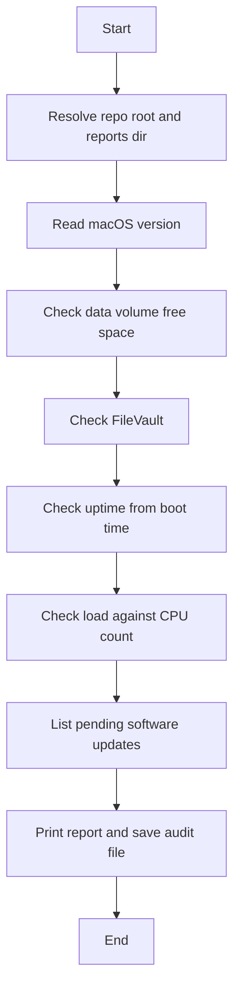

# Endpoint Health Audit

A read-only endpoint health audit. The macOS script is implemented. The Windows script is planned.

## Problem

Endpoint checks are easy to do differently every time: one person looks at disk space, another forgets FileVault, and a machine can sit unpatched or unrestarted for weeks. Notes from those checks are hard to compare later.

## Solution

`macos/health_audit.sh` collects six checks and writes one report with `[OK]`, `[WARNING]`, and `[ERROR]` lines. It does not change settings and does not need `sudo`.

Three warnings are deliberate:

- **FileVault Off** is a warning because disk encryption is a baseline endpoint control.
- **Pending software updates** are a warning because an available update is the finding.
- **1-minute load above the CPU count** is a warning because that is the usual rule of thumb for a saturated machine.

The report contains a timestamp, the checks, and a summary. It does not include the hostname or serial number.

## Tech stack

- bash 3.2 (the bash shipped with macOS) and macOS commands: `sw_vers`, `df`, `fdesetup`, `sysctl`, and `softwareupdate`
- [ShellCheck](https://www.shellcheck.net/) for the script
- Windows: PowerShell, not written yet

## How to run (macOS)

From the repo root, or from any other directory:

```bash
bash macos/health_audit.sh
```

The script creates `reports/audit-YYYY-MM-DD.txt` and prints the same text. A second run on the same day replaces that file. `reports/` is gitignored.

`softwareupdate -l` can take up to 3 minutes and needs network access for a full scan. If it is still running after 180 seconds, that check is marked `[ERROR]` and the rest of the report is still saved.

Thresholds can be overridden for a single run:

```bash
DISK_WARN_PCT=90 bash macos/health_audit.sh
UPTIME_WARN_DAYS=1 bash macos/health_audit.sh
LOAD_CPU_LIMIT=1 bash macos/health_audit.sh
```

`DISK_WARN_PCT` defaults to 15 (warn under 15% free). `UPTIME_WARN_DAYS` defaults to 14 (warn over 14 days). `LOAD_CPU_LIMIT` defaults to empty, which uses the logical CPU count.

The script exits 0 when the report file is written, including when the report contains warnings. It exits non-zero only when the report directory or file cannot be created.

## Flow



## Results

Placeholder. A sample report will be added after a verified run.

## Tested on

Placeholder. macOS only. The Windows script is not implemented.

## Roadmap

1. Windows PowerShell script with the same six checks: OS version, free space on the system drive, BitLocker, last boot time, processor load, and pending Windows updates. Fill in the Windows column in `docs/check-comparison.md`.
2. A sample report and a Tested on line, using only output approved from a real run.
3. A GitHub Action that runs ShellCheck on `macos/health_audit.sh`.
4. More posture checks: SIP, Gatekeeper, and the application firewall on macOS; Microsoft Defender, firewall profiles, and a pending reboot on Windows.
5. Exit behavior for automation. This version exits 0 when the report file is written, even if it contains warnings, so a warning does not fail a scheduled job. A later change can exit non-zero when any `[WARNING]` or `[ERROR]` is present, once both platforms share that contract.
